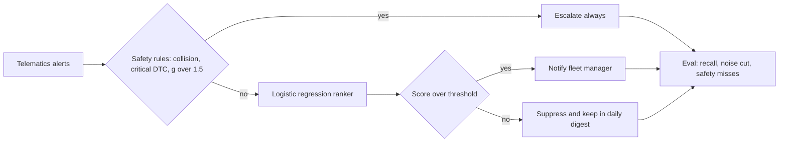
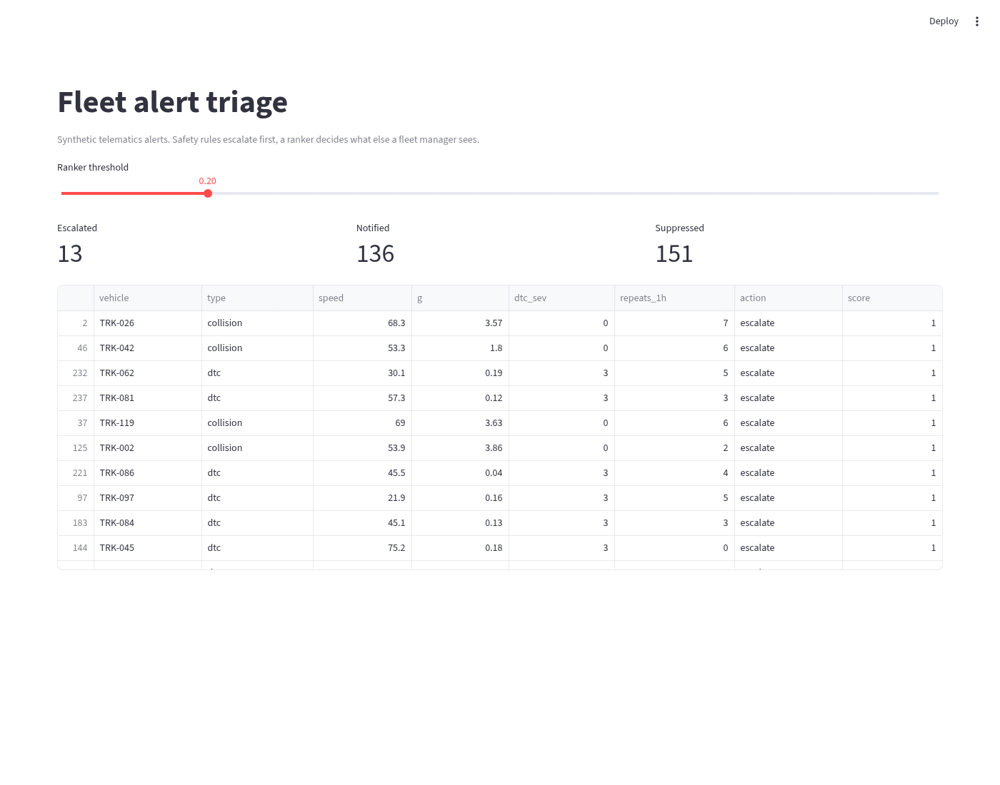
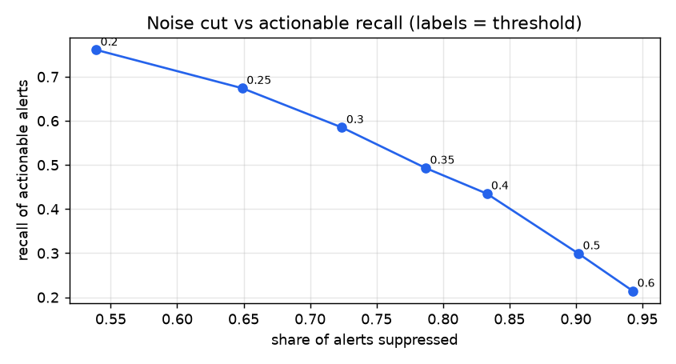

# Fleet alert triage with deterministic safety rules

**Data.** Seeded SYNTHETIC telematics alerts. No real fleet data.

## Problem
Fleet telematics devices send a flood of harsh braking, speeding, idle and engine fault alerts. Fleet managers stop reading them, and the alerts that matter get lost. ZenduIT wants AI that ranks alerts and cuts noise while keeping safety logic deterministic.

## Why I built it
The ZenduIT AI Product Builder posting is about turning IoT and telematics data into useful product features. I built the core loop: hard safety rules that a model can never override, a ranker for everything else, and a threshold curve a product manager can use to choose how much noise to cut.

## Architecture

More detail in [docs/architecture.md](docs/architecture.md).

## Screenshot


## Results
Measured by `python3 -m fleettriage.evaluate` on this repo (raw numbers in `results.json`).

Baseline shows all 2000 test alerts, and only 0.224 of them are actionable.

| Threshold | Alerts shown | Share suppressed | Actionable recall | Precision of shown |
|---|---|---|---|---|
| 0.2 | 922 | 0.539 | 0.761 | 0.37 |
| 0.25 | 702 | 0.649 | 0.674 | 0.43 |
| 0.3 | 551 | 0.724 | 0.585 | 0.475 |
| 0.35 | 426 | 0.787 | 0.493 | 0.519 |
| 0.4 | 335 | 0.833 | 0.435 | 0.582 |
| 0.5 | 196 | 0.902 | 0.299 | 0.684 |
| 0.6 | 114 | 0.943 | 0.214 | 0.842 |

Safety critical alerts in test: 70, missed: 0. Latency 0.068 ms per alert. Default threshold is 0.2.



## Design decisions
| Decision | Why | Tradeoff |
|---|---|---|
| Rules before the model | Safety alerts must never depend on a score | Rules need upkeep as devices change |
| Logistic regression ranker | Fast, explainable per feature, easy to ship on device or server | Lower ceiling than boosted trees |
| Suppress into a digest, not delete | Nothing is lost and managers can audit | Digest still needs a home in the product |
| Expose the threshold curve | Lets product choose the noise to recall tradeoff per customer | Needs a sensible default |
| Synthetic noisy labels | No public labelled fleet alert data | Numbers show the method, not real fleet performance |

## Limitations
Labels are synthetic and noisy on purpose, so precision is modest. At the default threshold the ranker still misses about a quarter of non critical actionable alerts, which is why suppressed alerts go to a digest rather than being dropped.

## Next steps
Train on real ZenduIT alert and acknowledgement history, add per fleet thresholds, dedupe bursts by vehicle and window, and use an LLM only to summarise the digest.

## How to run
```bash
pip install -r requirements.txt
python3 -m pytest -q
python3 -m fleettriage.evaluate
streamlit run app/streamlit_app.py
```
