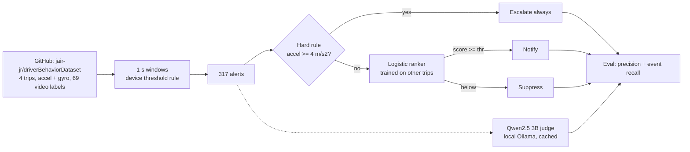
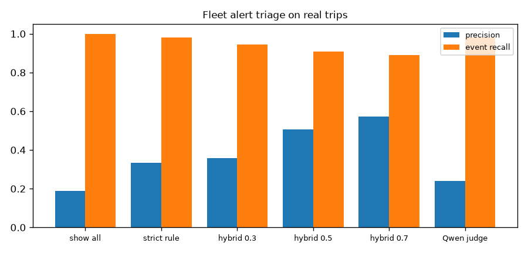
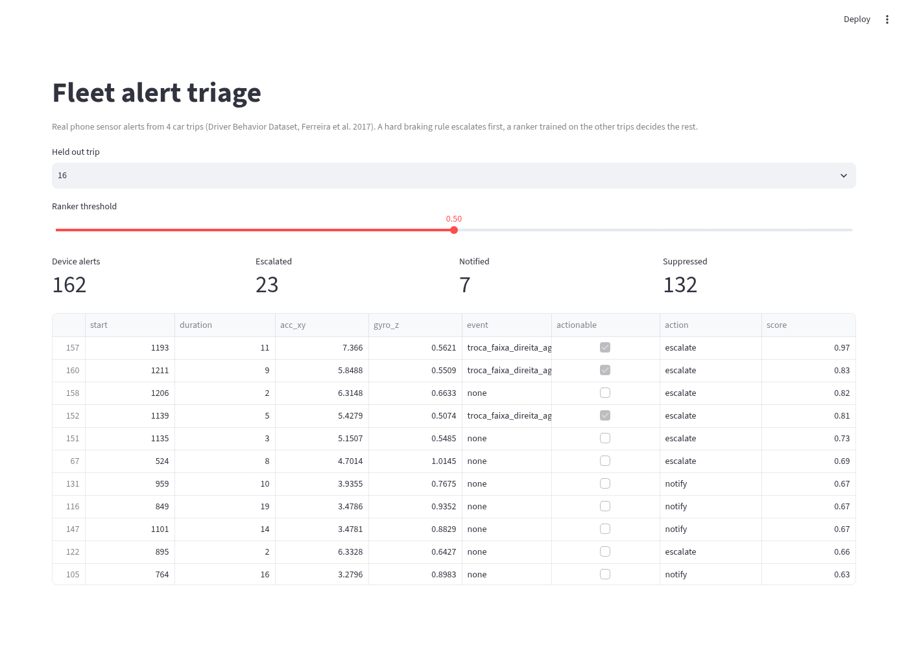

# Fleet alert triage (real driving data)

Cut noisy telematics alerts while keeping every hard braking alert. Built on real phone sensor data from 4 labelled car trips.

## Data (real, with sources)
- **Driver Behavior Dataset** (Ferreira, Carvalho et al., "Driver behavior profiling", PLOS ONE 2017), from https://github.com/jair-jr/driverBehaviorDataset. 4 real car trips (2011 Honda Civic, phone on windshield), linear acceleration and gyroscope at 50 to 200 Hz, and 69 events labelled from video (55 aggressive, 14 non aggressive). Stored in `data/driverBehavior/`.
- **Licence:** the repo has no licence file. The paper is open access (CC BY 4.0). Used here for research with attribution. Check with the authors before any commercial use.
- Alerts are not in the dataset. A device style rule (accel >= 2 m/s^2 or yaw rate >= 0.35 rad/s in any 1 s window) makes 317 alerts. An alert is "actionable" if it overlaps a labelled aggressive event (60 of 317).
- Why not Grab "Safety" data on Hugging Face: the copy there (SanaullahTareen07/grab-safe-driver-telematics-cleaned-dataset) has sensor rows but no dangerous trip labels and no licence. The old synthetic generator is kept as `fleettriage/data_synthetic.py`, labelled SYNTHETIC.

## Architecture

More detail in [docs/architecture.md](docs/architecture.md).

## Design tradeoffs
| Decision | Why | Tradeoff |
|---|---|---|
| Rebuild alerts from raw sensors | The dataset has events, not alerts | Alert counts depend on my thresholds |
| Leave one trip out | Only 4 trips, so no leakage between trips | Very small test sets, noisy numbers |
| Hard rule before ranker | Hard braking must never be hidden | 81 rule hits include many unlabelled ones, so precision drops |
| Event recall as main metric | A manager cares about missed events, not alert count | Unlabelled aggressive moments count as noise |
| Qwen as a zero shot judge only | Shows what an LLM does with numbers, no training | Slow on CPU (about 5 s per alert) and weak |

## Results
| Variant | Alerts shown (of 317) | Precision | Aggressive events caught (of 55) |
|---|---|---|---|
| show_all | 317 | 0.189 | 55 (1.0) |
| strict_rule (acc>=3 or gyro>=0.6) | 158 | 0.335 | 54 (0.982) |
| hybrid (rule + ranker, thr 0.3) | 142 | 0.359 | 52 (0.945) |
| hybrid (rule + ranker, thr 0.5) | 95 | 0.505 | 50 (0.909) |
| hybrid (rule + ranker, thr 0.7) | 82 | 0.573 | 49 (0.891) |
| qwen2.5-3b judge | 237 | 0.241 | 54 (0.982) |

Leave one trip out: the ranker is always trained on the other 3 trips. The hard safety rule (horizontal accel >= 4 m/s^2) fires on 81 alerts and can never be suppressed.



## Error analysis
- Qwen showed 237 of 317 alerts (precision 0.241), barely better than showing everything (0.189). It said "show" for most alerts with any value above about 3 m/s^2. The simple strict rule beat it (0.335 precision, 54 of 55 events).
- The hybrid at threshold 0.5 cut alerts from 317 to 95 and raised precision to 0.505, but missed 5 of 55 aggressive events. At 0.3 it missed 3. The strict rule missed only 1 with more alerts. There is a real tradeoff, not a free win.
- Many "noise" alerts with high scores (see UI) sit between labelled events. The drivers likely drove hard there too, but it was not labelled. So precision is a lower bound.

## Limitations
- Only 4 trips, 2 drivers, one car, dry roads. Numbers are noisy.
- Labels cover planned manoeuvres only.
- No GPS speed, no vehicle fault codes, no real collisions.
- Licence is unclear for commercial use.

## UI


## How to run
```bash
pip install -r requirements.txt
bash scripts/download_data.sh            # real trips from GitHub, about 40 MB
python -m fleettriage.evaluate          # baselines + hybrid
python -m fleettriage.llm_judge         # Qwen judge, replays data/llm_cache.json
LLM=ollama python -m fleettriage.llm_judge   # live, needs ollama with qwen2.5-3b
pytest -q
streamlit run app/streamlit_app.py
```
