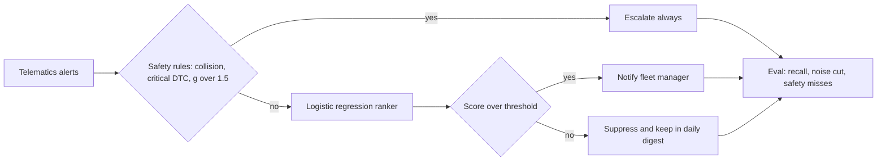

# Architecture

`fleettriage/data.py` generates 6,000 seeded synthetic alerts across 8 event types with speed, g force, fault severity, night driving, driver history and repeat counts, with noisy labels. `fleettriage/model.py` applies safety rules first and then a logistic regression ranker. `fleettriage/evaluate.py` trains on 4,000 and tests on 2,000 alerts and sweeps the threshold.

## Design decisions

| Decision | Why | Tradeoff |
|---|---|---|
| Rules before the model | Safety alerts must never depend on a score | Rules need upkeep as devices change |
| Logistic regression ranker | Fast, explainable per feature, easy to ship on device or server | Lower ceiling than boosted trees |
| Suppress into a digest, not delete | Nothing is lost and managers can audit | Digest still needs a home in the product |
| Expose the threshold curve | Lets product choose the noise to recall tradeoff per customer | Needs a sensible default |
| Synthetic noisy labels | No public labelled fleet alert data | Numbers show the method, not real fleet performance |
