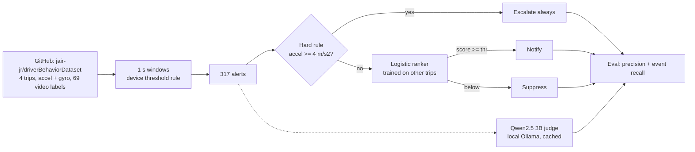

# Architecture

## Data sources

- **Driver Behavior Dataset** (Ferreira, Carvalho et al., "Driver behavior profiling", PLOS ONE 2017), from https://github.com/jair-jr/driverBehaviorDataset. 4 real car trips (2011 Honda Civic, phone on windshield), linear acceleration and gyroscope at 50 to 200 Hz, and 69 events labelled from video (55 aggressive, 14 non aggressive). Stored in `data/driverBehavior/`.
- **Licence:** the repo has no licence file. The paper is open access (CC BY 4.0). Used here for research with attribution. Check with the authors before any commercial use.
- Alerts are not in the dataset. A device style rule (accel >= 2 m/s^2 or yaw rate >= 0.35 rad/s in any 1 s window) makes 317 alerts. An alert is "actionable" if it overlaps a labelled aggressive event (60 of 317).
- Why not Grab "Safety" data on Hugging Face: the copy there (SanaullahTareen07/grab-safe-driver-telematics-cleaned-dataset) has sensor rows but no dangerous trip labels and no licence. The old synthetic generator is kept as `fleettriage/data_synthetic.py`, labelled SYNTHETIC.

## Design tradeoffs

| Decision | Why | Tradeoff |
|---|---|---|
| Rebuild alerts from raw sensors | The dataset has events, not alerts | Alert counts depend on my thresholds |
| Leave one trip out | Only 4 trips, so no leakage between trips | Very small test sets, noisy numbers |
| Hard rule before ranker | Hard braking must never be hidden | 81 rule hits include many unlabelled ones, so precision drops |
| Event recall as main metric | A manager cares about missed events, not alert count | Unlabelled aggressive moments count as noise |
| Qwen as a zero shot judge only | Shows what an LLM does with numbers, no training | Slow on CPU (about 5 s per alert) and weak |

## Limitations

- Only 4 trips, 2 drivers, one car, dry roads. Numbers are noisy.
- Labels cover planned manoeuvres only.
- No GPS speed, no vehicle fault codes, no real collisions.
- Licence is unclear for commercial use.
